<p align="center">
  <a href="https://designertube.app"></a>
</p>

<p align="center">
  <b><a href="https://designertube.app">designertube.app</a></b> ·
  <a href="#how-it-was-built">How it was built</a> ·
  <a href="#run-it-locally">Run it locally</a> ·
  <a href="#rebuild-the-dataset">Rebuild the dataset</a> ·
  <a href="#fork-it">Fork it</a>
</p>

---

YouTube's recommendations are tuned for watch time. They are very good at finding the next thing you will click, and not so good at finding the talk that changes how you design.

For almost twenty years, Hacker News readers, many of whom build interfaces for a living, have been pointing each other at exactly those videos: the HCI demo that still looks like the future, the typography lecture that finally made it click, the game-feel talk every UI designer should see. **DesignerTube** collects the design ones from every HN comment ever written, reads what people actually said about them, and turns them into a YouTube-style site you can browse, search and make your own.

It is the designer edition of [HackerTube](https://hackertube.org) by [@karpathy](https://x.com/karpathy), rebuilt the same way: Claude Opus in Claude Code coordinating teams of Claude Sonnet agents, from raw data to deployed site.

| | |
|---|---|
| **1,153** design videos | ranked by how many separate months HN people recommended them |
| **8,191** labeled HN comments | every one read and judged by Claude: recommend, cite, joke or criticize |
| **502,211** HN comments scanned | everything mentioning YouTube, 2007–2026 |
| **17** areas · **63** topics · **18** playlists | UX, interaction, typography, design systems, service design, industrial design, data viz, game design… |

<p align="center">
  
  
</p>

## What you can do

- **Home** mixes HN classics, hidden gems a few people love, recently recommended videos and topics you haven't explored. Once you like a few videos it adds similar ones and what the same HN people also recommended. Hover a card to see why it is there.
- **Every video page shows what Hacker News actually said**: the real comments, labeled by stance, with links back to the threads.
- **Search understands topics, not just keywords.** Lexical BM25 is fused with a semantic ranking, so "design tokens" also finds design-system talks that never say it.
- **Categories, Playlists, Longs** (an hour or more), Liked, History and Watch later. No accounts: your state lives in your browser.
- Thumbnails are YouTube's auto-generated frame from the **middle** of the video instead of the A/B-tested upload; playback uses the privacy-enhanced embed.
- Keyboard: `/` search, `j`/`k` move, `Enter` open, `l` like, `w` watch later, `t` theme, `?` all shortcuts.

## How it was built

```mermaid
flowchart LR
  A["Hacker News<br/>Algolia API"] -->|502K comments<br/>142K stories| B["Extract YouTube ids<br/>262K videos"]
  B -->|"≥2 people, ≥2 months"| C["36K candidates<br/>oEmbed titles: 33.7K live"]
  C -->|"Claude: is it design?"| D["2.5K design videos"]
  D -->|"Claude reads every<br/>linking comment"| E["10.4K labeled comments"]
  E -->|"≥2 recommenders<br/>in ≥2 months"| F["1.2K videos"]
  F -->|"Claude writes cards,<br/>duplicates merged"| G["1,153 videos"]
  G --> H["Embeddings, related,<br/>playlists, export"]
  H --> I["Next.js on Vercel"]
```



1. **Read all of Hacker News.** Every comment and story mentioning `youtube` or `youtu.be` is pulled from the public [Algolia HN Search API](https://hn.algolia.com/api) ([`01_collect.py`](pipeline/01_collect.py)), and video ids are extracted from every link format ([`02_extract.py`](pipeline/02_extract.py)).
2. **Keep what HN keeps coming back to.** Candidates are videos linked by at least two different people in at least two different months. Titles and channels come from YouTube's keyless oEmbed endpoint, which also drops deleted and private videos ([`03_titles.py`](pipeline/03_titles.py)).
3. **Find the design videos.** Claude Sonnet read the title, channel and HN thread titles of all 33,661 candidates and labeled each one `core` (about design), `adjacent` (valuable to designers) or `no`. An embedding prefilter was tried first and dropped: it ranked *Inventing on Principle* below Tim Minchin songs.
4. **Read every comment.** A link isn't always a recommendation. Claude read each comment linking a design video, with the thread it was posted in, and labeled its stance (`strong`, `rec`, `reference`, `joke`, `critique`, `bare`), a short why and a verbatim quote.
5. **Threshold on real recommendations.** A video stays if at least two distinct people recommended it in at least two distinct months. (HackerTube uses three and three; design is a smaller slice of HN.)
6. **Write a card for every video.** Summary, why HN likes it, type, level, shelf life (`evergreen` / `dated` / `historical`), tags and 1–3 categories from a design taxonomy, plus a final design check. Re-uploads of the same talk (*Inventing on Principle* existed three times) were reviewed and merged, pooling their HN history.
7. **Rank by lasting recommendation:** score = months recommended + a bonus for emphatic recommendations. Being recommended again and again over the years beats one viral spike.
8. **Export** ([`05_export.py`](pipeline/05_export.py)): bge-small embeddings for "similar videos" and semantic search, "HN people also recommend" from shared recommenders, playlists curated by Claude, a route table, and the downloadable dataset.

The LLM stages ([`04_llm.py`](pipeline/04_llm.py)) write batch files; each batch was handed to a Claude Sonnet subagent with the instructions in [`pipeline/prompts/`](pipeline/prompts). About 90 agent runs in total, up to 20 in parallel, each validated by line count and JSON parsing before the next stage.

## Tech stack

| Layer | Choice |
|---|---|
| Data | Python 3.11 (stdlib + `numpy`, `fastembed` with `BAAI/bge-small-en-v1.5`) |
| Labeling | Claude Sonnet subagents, coordinated by Claude Opus in Claude Code |
| Site | Next.js 16 (App Router, Cache Components, Partial Prefetching), React 19, TypeScript, plain CSS |
| Hosting | Vercel. ~3,600 prerendered pages; three small JSON API routes for the feed, search and lists |
| Video metadata | YouTube oEmbed (no key) and, optionally, the YouTube Data API for upload dates, durations and views |

There is no database. The dataset ships as JSON in [`web/data/`](web/data) and is read by server components and route handlers.

## SEO

Every video has a permanent, slugged URL (`/watch/{id}/{title-slug}`); `/watch/{id}`, renamed titles and merged re-uploads 308 to it, and unknown ids get a real 404. A [`proxy.ts`](web/proxy.ts) does this before anything renders. The site also has:

- `sitemap.xml` with all 1,259 URLs and a Google video-sitemap entry for each video (title, description, thumbnail, player, duration, views, publish date), XML-escaped
- `robots.txt`, canonical URLs, per-page titles and descriptions, Open Graph (`og:video`) and Twitter cards, a generated share image, icons and a web manifest
- JSON-LD: `VideoObject` (with HN comments as `Comment`), `BreadcrumbList`, `CollectionPage`/`ItemList`, `WebSite` with `SearchAction`, `Organization`
- A server-rendered first page of the feed so crawlers see real links without running JavaScript

## Run it locally

Requires Node 20+ and [pnpm](https://pnpm.io). The dataset is in the repo, so the site runs without touching the pipeline.

```bash
cd web
pnpm install
pnpm dev          # http://localhost:3000
pnpm build        # full production build (prerenders every page)
```

Configuration, all optional ([`web/.env.example`](web/.env.example)):

| Variable | Purpose |
|---|---|
| `NEXT_PUBLIC_SITE_URL` | Canonical origin for canonical URLs, sitemap and JSON-LD. Defaults to `https://designertube.app`; **set it to your own domain if you fork.** |
| `GOOGLE_SITE_VERIFICATION`, `BING_SITE_VERIFICATION` | Search console verification meta tags |

Deploy: import the `web/` directory into Vercel (framework: Next.js) or run `vercel deploy --prod` from `web/`.

## Rebuild the dataset

You only need this to refresh the data or adapt the pipeline to another field. The raw working data (~2.4 GB) is not in the repo.

```bash
cd pipeline
python3 -m venv .venv && .venv/bin/pip install -r requirements.txt

python3 01_collect.py          # 15–40 min: HN comments and stories mentioning YouTube
python3 02_extract.py          # video ids, mentions, per-video stats
python3 03_titles.py 2 2       # oEmbed titles for candidates (≥2 people, ≥2 months)

python3 04_llm.py relevance    # writes data/llm/relevance/in_*.jsonl
#   → give each batch to an agent: prompts/_procedure.md + prompts/relevance.md, write out_*.jsonl
python3 04_llm.py label        # then prompts/label.md
python3 04_llm.py card         # then prompts/card.md  (taxonomy: taxonomy_seed.json)
python3 04_llm.py status       # which batches are done

.venv/bin/python 05_export.py  # → web/data/*.json and web/public/data/designertube-data.zip
python3 06_playlists.py        # input for prompts/playlists.md → playlists.json, then re-export

cp .env.example .env           # optional: add a free YouTube Data API key
python3 07_youtube.py && .venv/bin/python 05_export.py
```

The LLM steps are written for coding agents (Claude Code subagents), but the prompts are plain instructions over JSONL files, so any batch LLM runner works. The full run read about 34K video titles and 10K comments and wrote 1.2K cards.

The YouTube API key stays on your machine: it is read from `pipeline/.env` by `07_youtube.py` only, and just the fetched fields (upload date, duration, views) are written into `web/data`. YouTube's API policies ask for stored data to be refreshed periodically; rerun that step and redeploy every month or so.

## Repository layout

```
pipeline/            data pipeline (Python)
  01_collect.py … 07_youtube.py
  prompts/           instructions given to the labeling agents
  taxonomy_seed.json design areas and topics, with synonym-rich descriptions
  merges.json        duplicate uploads, reviewed by hand
  playlists.json     curated playlists
  DATA.md            dataset documentation (ships in the zip)
web/                 Next.js site
  app/               routes: home, watch, categories, playlists, search, sitemap, robots, OG image…
  components/        Shell, Feed, VideoCard, Watch…
  lib/               data access, feed mixer, hybrid search, SEO and JSON-LD helpers
  data/              the generated dataset the site reads
  proxy.ts           permalink redirects and 404s
docs/                images for this README
```

## Fork it

Everything here is meant to be reused. The easiest way: download the [data zip](https://designertube.app/data/designertube-data.zip) (videos, labeled comments, taxonomy, related videos, embeddings and a `DATA.md` written for agents), hand it to Claude Code or a similar agent, and ask for what you want: a different interface, a weekly email of talks in your areas, a terminal browser, an analysis.

To build the same thing for another field (architecture, music production, science communication…), swap the taxonomy and the rubric in [`prompts/relevance.md`](pipeline/prompts/relevance.md), rerun the pipeline and set `NEXT_PUBLIC_SITE_URL`.

## License and data

- **Code:** [MIT](LICENSE).
- **Dataset** (`web/data`, the zip): [ODC-By 1.0](https://opendatacommons.org/licenses/by/1-0/), like the Hacker News archive it is derived from. Please credit DesignerTube.
- **Comment text** belongs to its Hacker News authors and is included as it appears publicly on HN, with links back to the source.
- **Videos** belong to their creators and play through YouTube's embed. YouTube metadata (durations, views, dates) is shown on the site via the YouTube API and is not redistributed in the zip.

DesignerTube is an independent project, not affiliated with YouTube, Google, Hacker News or Y Combinator.

## Credits

Inspired by and modeled on [HackerTube](https://hackertube.org) by Andrej Karpathy. Data pipeline, labeling and site built by Claude (Anthropic) in Claude Code. Comments by the Hacker News community; search by [Algolia's HN API](https://hn.algolia.com/api).
