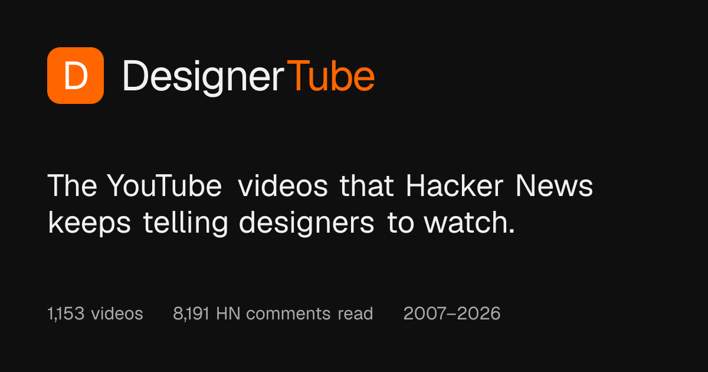
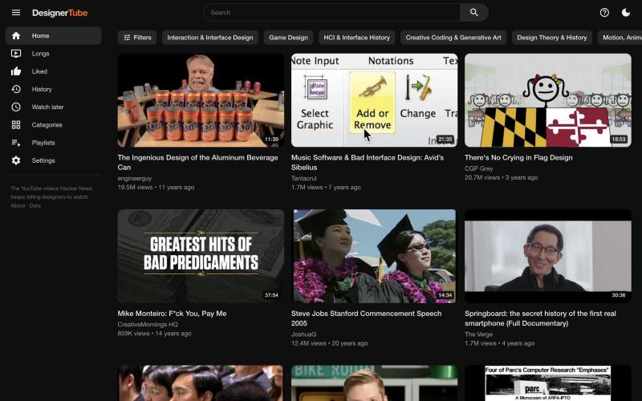
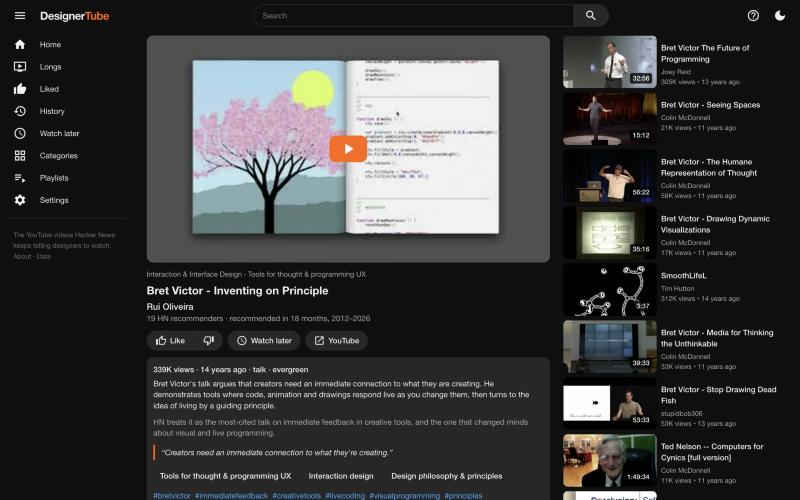
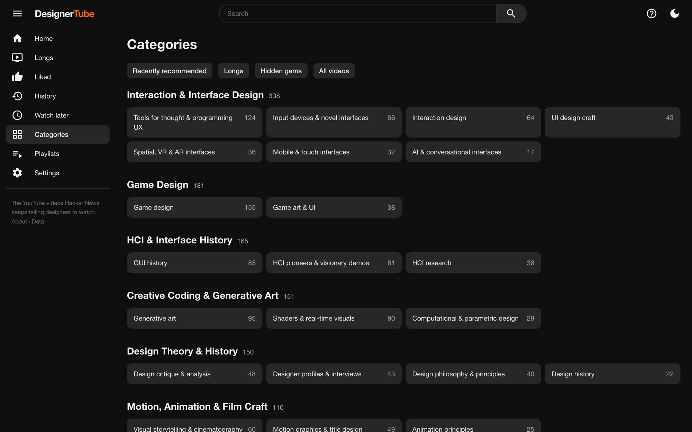
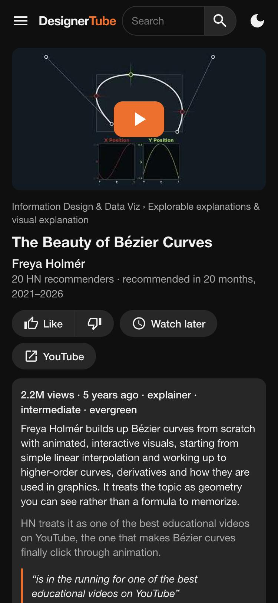
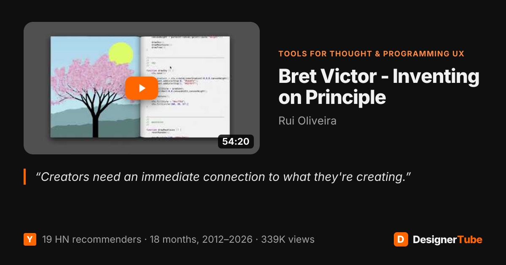
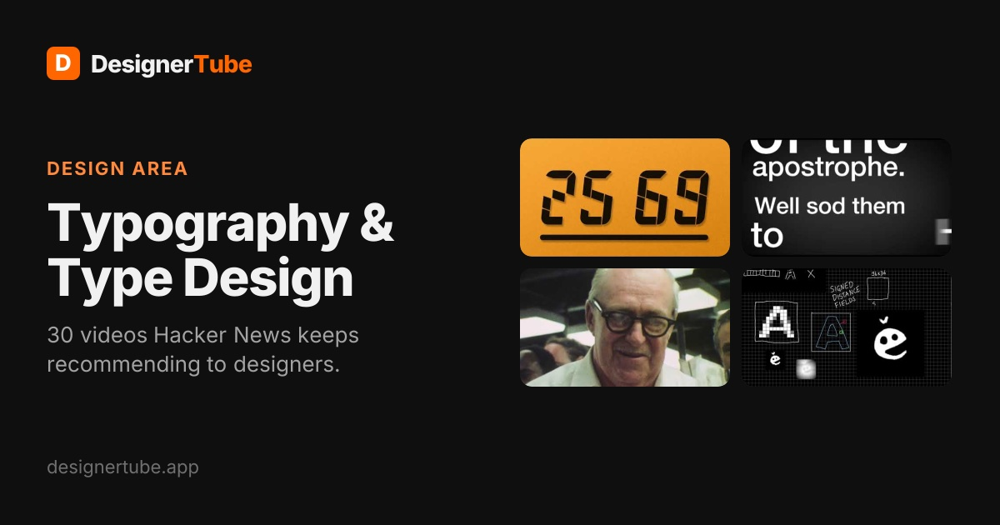

<p align="center">
  <a href="https://www.designertube.app"></a>
</p>

<h3 align="center">The YouTube videos that Hacker News keeps telling designers to watch.</h3>

<p align="center">
  <a href="https://www.designertube.app"><b>designertube.app</b></a> ·
  <a href="#the-designer-edition-of-hackertube">Why</a> ·
  <a href="#how-it-was-built">How it was built</a> ·
  <a href="#run-it-locally">Run it</a> ·
  <a href="#rebuild-the-dataset">Rebuild the data</a> ·
  <a href="#fork-it">Fork it</a>
</p>

<p align="center">
  
</p>

## The designer edition of HackerTube

In November 2026, [Andrej Karpathy](https://x.com/karpathy) [shared a weekend hack](https://x.com/karpathy/status/2116957135661945283): annoyed with YouTube's recommendations, he had Claude read twenty years of Hacker News, keep the videos people kept recommending to each other, and turn them into [**HackerTube**](https://hackertube.org), a YouTube without the engagement machine. It took a couple of hours of talking to Claude Code, and he published the dataset so anyone could point their own agent at it and build their own version.

**DesignerTube is that version, for designers.** Same idea, same method, same tools, aimed at the talks, lectures and documentaries that people who build interfaces keep sending each other: the HCI demo that still looks like the future, the typography lecture that finally made it click, the game-feel talk every UI designer should see.

Karpathy's tweet ended with a question, and this repo is one answer to it:

> “What else are we not thinking of.” — [@karpathy](https://x.com/karpathy/status/2116957135661945283)

|  | [HackerTube](https://hackertube.org) | DesignerTube |
|---|---|---|
| For | everyone on Hacker News | designers |
| Source | every HN comment, 2007–2026 | every HN comment and story mentioning YouTube, 2007–2026 |
| Bar to get in | ≥3 people in ≥3 different months | ≥2 people in ≥2 different months, **and** Claude judges it a design video |
| Result | 6,454 videos, 150 topics | **1,153 videos**, 63 design topics, 18 playlists |
| Built by | Claude Opus in Claude Code, coordinating Claude Sonnet agents | the same |
| Served from | a VPS | Next.js on Vercel |
| Data | one zip for your agent | one zip for your agent |

Everything here, from the scrapers and the labeling prompts to the site, its SEO and this README, was built by talking to Claude Code, the way Karpathy describes it: the human did the browser chores (a YouTube API key, a domain) and Claude did the rest.

## By the numbers

| | |
|---|---|
| **502,211** HN comments + **141,539** stories scanned | everything mentioning YouTube, 2007–2026 |
| **261,781** distinct videos found | **36,371** linked by ≥2 people in ≥2 months |
| **33,661** candidates judged by Claude | **2,501** are about design or valuable to designers |
| **10,441** comments read and labeled | recommend · cite · joke · criticize |
| **1,153** videos on the site | ranked by how many separate months HN recommended them |

<p align="center">
  
</p>

## What you can do

- **Home** mixes HN classics, hidden gems a few people love, recently recommended videos and topics you haven't explored. Like a few videos and it adds similar ones, plus what the same HN people also recommended. Hover a card to see why it is there.
- **Every video page shows what Hacker News actually said:** the real comments, labeled by stance, with links back to the threads, a summary, why HN likes it, and how well it has aged.
- **Search understands topics, not just keywords.** BM25 is fused with a semantic ranking, so "design tokens" also finds design-system talks that never say it.
- **Categories, Playlists and Longs** (an hour or more), plus Liked, History and Watch later. No accounts: your state lives in your browser.
- Thumbnails are YouTube's auto-generated frame from the **middle** of the video, not the A/B-tested upload. Playback uses the privacy-enhanced embed.
- Keyboard: `/` search, `j`/`k` move, `Enter` open, `l` like, `w` watch later, `t` theme, `?` all shortcuts.

<p align="center">
  
  &nbsp;
  
</p>

## How it was built

```mermaid
flowchart LR
  A["Hacker News<br/>(Algolia API)"] -->|"502K comments<br/>142K stories"| B["Extract YouTube ids<br/>262K videos"]
  B -->|"≥2 people,<br/>≥2 months"| C["36K candidates<br/>33.7K still online"]
  C -->|"Claude:<br/>is it design?"| D["2.5K design videos"]
  D -->|"Claude reads every<br/>linking comment"| E["10.4K labeled<br/>comments"]
  E -->|"≥2 recommenders<br/>in ≥2 months"| F["1.2K videos"]
  F -->|"Claude writes cards,<br/>re-uploads merged"| G["1,153 videos"]
  G --> H["Embeddings, related,<br/>playlists, export"]
  H --> I["Next.js<br/>on Vercel"]
```



1. **Read all of Hacker News.** Every comment and story mentioning `youtube` or `youtu.be` comes from the public [Algolia HN Search API](https://hn.algolia.com/api) ([`01_collect.py`](pipeline/01_collect.py)); video ids are pulled out of every link format ([`02_extract.py`](pipeline/02_extract.py)).
2. **Keep what HN keeps coming back to.** Candidates are videos linked by at least two different people in at least two different months. Titles and channels come from YouTube's keyless oEmbed endpoint, which also drops deleted and private videos ([`03_titles.py`](pipeline/03_titles.py)).
3. **Find the design videos.** Claude Sonnet read the title, channel and HN thread titles of all 33,661 candidates and labeled each `core` (about design), `adjacent` (valuable to designers) or `no`. An embedding prefilter was tried first and thrown out: it ranked *Inventing on Principle* below Tim Minchin songs.
4. **Read every comment.** A link isn't always a recommendation. Claude read each comment linking a design video, together with the thread it was posted in, and labeled its stance (`strong`, `rec`, `reference`, `joke`, `critique`, `bare`), a short reason and a verbatim quote.
5. **Threshold on real recommendations.** A video stays if at least two distinct people *recommended* it in at least two distinct months. HackerTube uses three and three; design is a smaller slice of HN.
6. **Write a card for every video:** summary, why HN likes it, type, level, shelf life (`evergreen`, `dated`, `historical`), tags and 1–3 categories from a [design taxonomy](pipeline/taxonomy_seed.json), plus a final design check. Re-uploads of the same talk (*Inventing on Principle* existed three times) were reviewed by hand and merged, pooling their HN history.
7. **Rank by lasting recommendation:** months recommended, plus a bonus for emphatic ones. Being recommended again and again over the years beats one viral spike.
8. **Export** ([`05_export.py`](pipeline/05_export.py)): bge-small embeddings for "similar videos" and semantic search, "HN people also recommend" from shared recommenders, playlists curated by Claude, a route table and the downloadable dataset.

The LLM stages ([`04_llm.py`](pipeline/04_llm.py)) write JSONL batches. Each batch went to a Claude Sonnet subagent with the instructions in [`pipeline/prompts/`](pipeline/prompts): about 90 agent runs, up to 20 in parallel, each validated by line count and JSON parsing before the next stage started.

## Share cards and SEO

Every page has its own generated 1200×630 Open Graph image: one per video, topic and playlist, plus the site card above, drawn with [`next/og`](web/lib/og.tsx) from the video's mid-point frame and its HN stats, then cached.

<p align="center">
  
  
</p>

- **Permalinks** `/watch/{id}/{title-slug}`. `/watch/{id}`, old slugs and merged re-uploads 308 to them, and unknown ids get a real 404 from [`proxy.ts`](web/proxy.ts) before anything renders.
- **`sitemap.xml`** with all 1,259 URLs and a Google video-sitemap entry per video (title, description, thumbnail, player, duration, views, publish date), plus an RSS feed of recently recommended videos at `/feed.xml`.
- **JSON-LD:** `VideoObject` with upload date, duration, views and the HN comments as `Comment`; `BreadcrumbList`; `CollectionPage`/`ItemList`; `WebSite` with `SearchAction`; `Organization`.
- **On every page:** canonical URL, a title and a snippet-length description, Open Graph (`og:video`) and Twitter cards, `noindex` on search and personal pages, robots.txt, a web manifest and icons.
- **Server-rendered first page of the feed**, so crawlers see real links without running JavaScript. An [IndexNow](https://www.indexnow.org) script pings Bing and friends after a deploy.

## Tech stack

| Layer | Choice |
|---|---|
| Data | Python 3.11: stdlib, plus `numpy` and `fastembed` (`BAAI/bge-small-en-v1.5`) for embeddings |
| Labeling | Claude Sonnet subagents, coordinated by Claude Opus in Claude Code |
| Site | Next.js 16 (App Router, Cache Components, Partial Prefetching), React 19, TypeScript, plain CSS |
| Hosting | Vercel: ~3,600 prerendered pages and three small JSON routes for the feed, search and lists |
| Video metadata | YouTube oEmbed (no key) and the YouTube Data API for upload dates, durations and views |
| Analytics | Vercel Web Analytics: cookieless page-view counts, no personal identifiers |

There is no database. The dataset ships as JSON in [`web/data/`](web/data) and is read by server components and route handlers.

## Run it locally

Requires Node 20+ and [pnpm](https://pnpm.io). The dataset is in the repo, so the site runs without touching the pipeline.

```bash
cd web
pnpm install
pnpm dev          # http://localhost:3000
pnpm build        # production build: prerenders every page
```

Configuration is optional ([`web/.env.example`](web/.env.example)):

| Variable | Purpose |
|---|---|
| `NEXT_PUBLIC_SITE_URL` | Canonical origin for canonical URLs, sitemap, feed and JSON-LD. Defaults to `https://www.designertube.app`; **set your own domain if you fork.** |
| `GOOGLE_SITE_VERIFICATION`, `BING_SITE_VERIFICATION` | Search console verification meta tags |

Deploy by importing `web/` into Vercel (framework: Next.js) or running `vercel deploy --prod` from `web/`. After a production deploy, `node scripts/indexnow.mjs` submits the sitemap to IndexNow; forks should replace the key file in `web/public/` with their own.

## Rebuild the dataset

Only needed to refresh the data or adapt the pipeline to another field. The raw working data (about 2.4 GB) is not in the repo.

```bash
cd pipeline
python3 -m venv .venv && .venv/bin/pip install -r requirements.txt

python3 01_collect.py          # 15–40 min: HN comments and stories mentioning YouTube
python3 02_extract.py          # video ids, mentions, per-video stats
python3 03_titles.py 2 2       # oEmbed titles for candidates (≥2 people, ≥2 months)

python3 04_llm.py relevance    # writes data/llm/relevance/in_*.jsonl
#   give each batch to an agent with prompts/_procedure.md + prompts/relevance.md → out_*.jsonl
python3 04_llm.py label        # then prompts/label.md
python3 04_llm.py card         # then prompts/card.md (taxonomy: taxonomy_seed.json)
python3 04_llm.py status       # which batches are done

.venv/bin/python 05_export.py  # → web/data/*.json and web/public/data/designertube-data.zip
python3 06_playlists.py        # input for prompts/playlists.md → playlists.json, then export again

cp .env.example .env           # add a free YouTube Data API key
python3 07_youtube.py && .venv/bin/python 05_export.py
```

The prompts are plain instructions over JSONL files, written for coding agents like Claude Code subagents, but any batch LLM runner works. The full run read about 34K video titles and 10K comments and wrote 1.2K cards.

The YouTube API key never leaves your machine: `07_youtube.py` reads it from `pipeline/.env` (git-ignored), and only the fetched fields (upload date, duration, views) are written to `web/data`. YouTube's API policies ask for stored data to be refreshed periodically, so rerun that step and redeploy every month or so.

## Repository layout

```
pipeline/            data pipeline (Python)
  01_collect.py …    one script per stage, 01 → 07
  prompts/           instructions given to the labeling agents
  taxonomy_seed.json design areas and topics, with synonym-rich descriptions
  merges.json        duplicate uploads, reviewed by hand
  playlists.json     curated playlists
  DATA.md            dataset documentation (ships in the zip)
web/                 Next.js site
  app/               routes: home, watch, categories, playlists, search, sitemap, feed, OG images…
  components/        Shell, Feed, VideoCard, Watch…
  lib/               data access, feed mixer, hybrid search, SEO, JSON-LD and OG helpers
  data/              the generated dataset the site reads
  assets/fonts/      Inter (OFL) for the share images
  proxy.ts           permalink redirects and real 404s
docs/                images for this README
```

## Fork it

Everything here is meant to be reused, in the spirit of HackerTube's own zip. The quickest way: download the [data zip](https://www.designertube.app/data/designertube-data.zip) (videos, labeled comments, taxonomy, related videos, embeddings and a `DATA.md` written for agents), hand it to Claude Code or a similar agent, and ask for what you want: a different interface, a weekly email of talks in your areas, a terminal browser, an analysis.

To build the same thing for another field (architecture, music production, science communication…), swap the taxonomy and the rubric in [`prompts/relevance.md`](pipeline/prompts/relevance.md), rerun the pipeline and set `NEXT_PUBLIC_SITE_URL`.

## License and data

- **Code:** [MIT](LICENSE).
- **Dataset** (`web/data`, the zip): [ODC-By 1.0](https://opendatacommons.org/licenses/by/1-0/), like the Hacker News archive it is derived from. Please credit DesignerTube.
- **Comment text** belongs to its Hacker News authors and is included as it appears publicly on HN, with links back to the source.
- **Videos** belong to their creators and play through YouTube's embed. YouTube metadata (durations, views, dates) is shown on the site via the YouTube API and is not redistributed in the zip.
- **Inter** font by Rasmus Andersson, [SIL Open Font License](web/assets/fonts/LICENSE-Inter-OFL.txt).

DesignerTube is an independent project, not affiliated with YouTube, Google, Hacker News or Y Combinator.

## Credits

- **[Andrej Karpathy](https://x.com/karpathy)** for [HackerTube](https://hackertube.org), the idea, the method and the invitation to build your own version. DesignerTube is a love letter to that weekend hack.
- **The Hacker News community**, whose twenty years of "you have to watch this" are the whole dataset.
- **Claude** (Anthropic), which built the pipeline, labeled the comments, wrote the cards and shipped the site in Claude Code.
- **[Algolia](https://hn.algolia.com/api)** for the HN search API.
